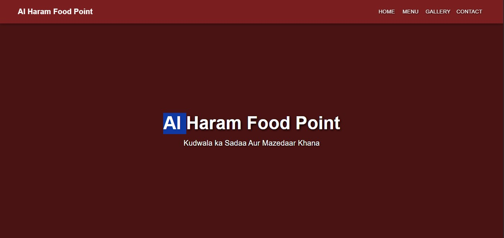
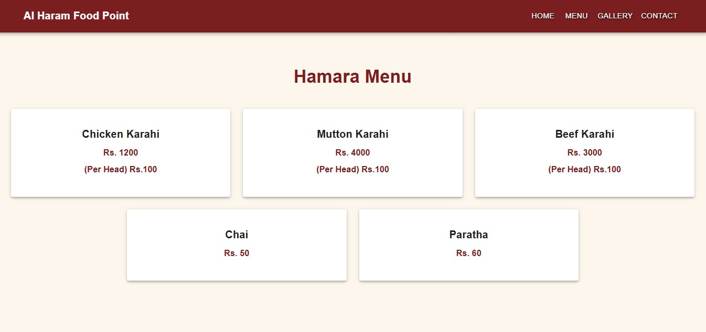
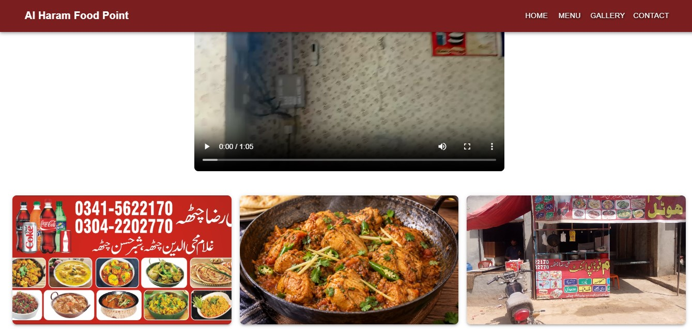
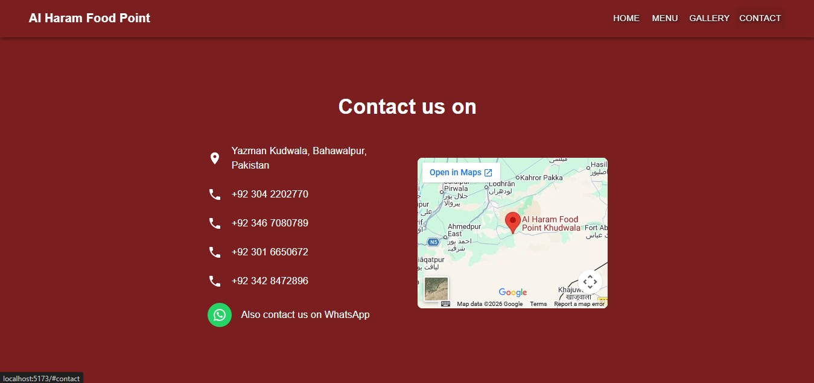

# Al Haram Food Point

A simple website for **Al Haram Food Point**, our family-run dhaba in Kudwala, Yazman, Bahawalpur (on Fort Abbas Road). People from nearby areas can use the website to see our menu, look at photos and videos, and find our contact details.

We do not take online orders. The website is only for showing information about the dhaba.

**Live Demo:** _https://family-hotel.vercel.app/_

## Features

### Home
- Shows the name of the dhaba with a short welcome line.

### Menu
- A list of the food items we serve, with prices.
- Visitors can see what we have before they visit.

### Gallery
- Photos and a video of the dhaba and our food.

### Contact
- Address, phone numbers and a WhatsApp link.
- A Google Map showing where the dhaba is.

### UI
- Responsive layout built with Material UI, so it works on mobile and desktop.

## Tech Stack

- **Frontend:** React (Vite), Material UI
- **Deployment:** Vercel

This is a frontend-only project. There is no backend or database.

## Project Structure

```
Family-Hotel/
└── my-hotel/     # React frontend
```

## Getting Started

### Installation

```bash
git clone https://github.com/zeenat2026/Family-Hotel.git
cd Family-Hotel/my-hotel
npm install
npm run dev
```

Then open `http://localhost:5173` in your browser.

## Screenshots






## Author

**Zeenat Shafqaat**
[LinkedIn](https://www.linkedin.com/in/zeenat-shafqaat/) · [GitHub](https://github.com/zeenat2026/Family-Hotel)